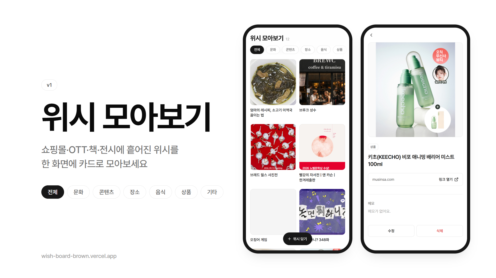

# 위시 모아보기 v1



> 쇼핑몰·OTT·책·전시에 흩어진 위시를 한 화면에 카드로 모아보는 앱

**배포 URL:** https://wish-board-brown.vercel.app

## 주요 기능

- **위시 담기:** 링크를 붙여넣으면 제목과 대표 이미지를 자동으로 불러온다. 링크가 없으면 제목만으로도 담을 수 있다.
- **직접 입력:** 자동으로 못 불러오는 사이트(쿠팡 등)는 제목과 이미지 주소를 직접 넣는다.
- **카드로 모아보기:** 담은 위시가 이미지 + 제목 카드로 한 화면에 모인다.
- **카테고리 필터:** 문화 / 콘텐츠 / 장소 / 음식 / 상품 / 기타 중 하나를 누르면 그 종류만 보인다.
- **상세 · 수정 · 삭제:** 카드를 누르면 링크 열기와 메모를 볼 수 있고, 수정하거나 삭제할 수 있다.

## 사용법

1. 첫 화면 아래의 **[+ 위시 담기]** 를 누른다.
2. **제목**을 쓰거나, **링크**를 붙여넣어 제목과 이미지가 자동으로 채워지게 한다.
   - "이 링크는 정보를 불러올 수 없어요"가 뜨면 제목을 직접 쓰고, 필요하면 **[이미지 직접 넣기]** 로 이미지 주소를 넣는다.
3. **카테고리**를 하나 고르고, 메모는 원하면 쓴 뒤 **[저장]** 한다.
4. 첫 화면 위쪽의 카테고리 버튼을 누르면 그 종류만 볼 수 있다.
5. 카드를 누르면 상세 화면에서 **[링크 열기]**, **[수정]**, **[삭제]** 를 할 수 있다.

## 실행 방법 (로컬)

Node.js 18 이상과 Supabase 프로젝트가 필요하다.

```bash
cd 졸업작품
npm install
cp .env.example .env   # DATABASE_URL에 Supabase 연결 주소를 넣는다
npm start              # http://localhost:3001
```

- `DATABASE_URL`은 Supabase 대시보드 → **Connect** → **Transaction pooler**(포트 6543) 주소를 쓴다. Direct connection(`db.…supabase.co`)은 IPv6 전용이라 IPv4 네트워크와 Vercel에서 접속되지 않는다.
- `wishes` 테이블은 서버가 처음 요청을 받을 때 자동으로 만든다.

**배포 (Vercel CLI)**

```bash
vercel env add DATABASE_URL production   # 처음 한 번
vercel --prod
```

## 기술 스택

| 영역 | 사용 기술 |
|---|---|
| 화면 | `index.html` 하나 — React 18(CDN) + Tailwind CSS(CDN), 해시 라우팅 |
| 서버 | `server.js` — Express 5 |
| DB | Supabase Postgres (`pg`) |
| 배포 | Vercel |

## 파일 구조

```
졸업작품/
├── index.html    # 화면 4개 (목록 · 담기 · 상세 · 수정)
├── server.js     # 위시 API + 링크 미리보기 API
├── vercel.json   # Vercel 배포 설정
├── MISSION.md    # 무엇을 왜 만드는가
├── DEV.md        # 어떻게 만드는가 (단계 · 위험 요소)
├── DESIGN.md     # 컬러 · 폰트 · 컴포넌트 · 톤앤매너
└── thumbnail.png # 발표용 썸네일 (1920×1080)
```

## 알려진 한계

- **로그인이 없다.** 주소를 아는 사람은 누구나 위시를 보고 수정·삭제할 수 있다. (수업 시연용 v1)
- **자동 추출이 안 되는 사이트가 있다.** 2026-10-19 배포 서버 기준으로 쿠팡·오늘의집은 접근이 막히고, 넷플릭스는 제목만 가져온다. 이런 사이트는 직접 입력한다.
- 사이트에 따라 자동으로 가져온 제목 끝에 `- 후기` 같은 문구가 붙을 수 있다. 저장 전에 고치면 된다.

## 회고

핵심 기능인 '위시 담기 → 카드로 모아보기'를 MISSION.md와 DEV.md에 정한 단계대로 하나씩 쌓아 배포까지 끝냈고, 링크 10개와 제목만 쓴 위시 2개를 담아 12개가 카드로 보이고 카테고리 필터가 동작하는 성공 기준을 통과한 점이 가장 잘 됐다. 자동 추출이 실패해도 직접 입력으로 저장되게 먼저 만들어 둔 덕분에 쿠팡처럼 막히는 사이트가 있어도 기능이 멈추지 않았고, 에이전트와 대화하며 카테고리를 repov 앱 기준으로 다시 짜고, 화면 문구를 존댓말로 고치고, 카드에서 상세·수정·삭제로 들어가는 흐름을 더하면서 쓰기 편한 앱이 됐다. 아쉬운 점은 자동 추출이 사이트마다 결과가 달라서 오늘의집처럼 집에서는 되던 사이트가 배포 서버에서는 막히고 제목에 군더더기가 붙는 경우가 남았다는 것, 로그인이 없어 누구나 데이터를 고칠 수 있다는 것, 그리고 실제 폰과 다른 사람의 사용으로는 검증하지 못했다는 것이다. 다음 버전에서는 컬렉션 기능과 함께 이 부분들을 먼저 보완하고 싶다.
